# Qwen3.8 vs Qwen4 — 27B 4-bit comparison benchmark

100 original tasks with weights and difficulty tiers, built to compare **Qwen3.8-27B (4-bit)** with **Qwen4-27B
(4-bit)** as soon as Qwen4 lands on Hugging Face.

- **Calibrated for headroom:** the prior expected score of Qwen3.8-27B 4-bit (thinking on) is **≈ 50 / 100**. That
  leaves room above for Qwen4 to show improvement, and enough easy tasks to catch regressions.
- **Deterministic grading, no LLM judge:** every task is pass/fail by code. That means exact or numeric answers,
  hidden unit tests, executed SQL, constraint checkers, or the final state of a simulated environment.
- **Original and generated:** puzzles, documents and test data are produced by seeded generators, and every
  computable answer is computed in code (brute force, solvers, interpreters). So the answers are verified and the
  tasks are not copies of public benchmarks.
- **Zero dependencies:** Python 3.10+ standard library only. Talks to any OpenAI-compatible server (LM Studio,
  mlx_lm.server, llama.cpp, vLLM, SGLang, Ollama).

## At a glance

Each task's base weight is its tier (314 points in total). After the Qwen3.8 pilot, the weights were calibrated so
that the pilot scores exactly **50.0**: the 21 tasks Qwen3.8 failed count ×2.609, which makes 454 points in total.
The score is `100 × earned / total weight`. The calibrated weights live in `tasks/weights.json`; `tasks/tasks.jsonl`
(prompts, answers, graders) is unchanged. See [Pilot result and calibrated weights](#pilot-result-and-calibrated-weights).

| Tier | Weight | Tasks | Points | Prior pass rate (Qwen3.8) | Purpose |
|---|---:|---:|---:|---:|---|
| T1 warm-up | 1 | 8 | 8 | 0.97 | sanity / regression floor |
| T2 standard | 2 | 20 | 40 | 0.87 | solid everyday competence |
| T3 hard | 3 | 33 | 99 | 0.59 | where the 50 line is decided |
| T4 very hard | 4 | 28 | 112 | 0.41 | main headroom for Qwen4 |
| T5 frontier | 5 | 11 | 55 | 0.17 | ceiling: should rarely pass today |

| Category | Tasks | Points | What it measures | Graded by |
|---|---:|---:|---|---|
| math | 14 | 45 | number theory, combinatorics, probability, geometry | exact numbers / fractions |
| logic | 12 | 38 | logic grids, knights/knaves/spies, epistemic puzzle, scheduling, Sudoku | exact answers (uniqueness proven by solver) |
| code | 14 | 45 | algorithms with large-input time limits, strict spec parsing | hidden unit tests in a subprocess |
| instruction | 11 | 31 | stacked verifiable constraints (lipogram, acrostics, exact word counts) | constraint checkers |
| knowledge | 10 | 31 | long-tail facts (Unicode, RFCs, ISO codes, math history) | exact answers |
| long_context | 8 | 28 | needles with decoys, variable chasing, aggregation, state tracking (up to ~37k tokens) | exact answers |
| trace | 8 | 29 | executing code mentally: Python gotchas, stack/register machines, xorshift, Life, Rule 110, Brainfuck | exact output |
| agent | 8 | 24 | multi-turn tool use in simulated environments (pagination, stale caches, planning under a step budget) | final answer and/or final environment state |
| structured | 6 | 16 | JSON/CSV extraction, regex writing, SQLite (window functions, recursive CTE) | JSON/CSV checkers, regex test-suite, SQL executed on SQLite |
| science | 5 | 15 | physics, genetics, orbital mechanics, stereochemistry, term symbols | numeric tolerance / exact |
| multilingual | 4 | 12 | Turkish morphology and numbers, German numbers, Japanese morae | exact answers |

The full list (IDs, tiers, prior pass rates, titles; no answers) is in [tasks/TASKS.md](tasks/TASKS.md).

## Quick start

```bash
python3 selftest.py
```

The self-test proves the benchmark itself is sound, with no model involved. For every task, the reference answer
must pass. It must still pass when preceded by a `<think>` block that contains a wrong answer, and (for the 62
FINAL-ANSWER tasks) in 13 formats real models use: `**FINAL ANSWER**: x`, `Final Answer:`, a markdown heading, the
answer on the next line, `$x$`, `\boxed{x}`, backticks, a trailing period, a capitalised (or Turkish `İ`) first
letter, and so on. A plausible wrong answer must fail (88 tasks have one), and an empty reply must fail.

### 1. Serve Qwen3.8-27B 4-bit

Any OpenAI-compatible server works. On a Mac, the simplest is LM Studio with
[`lmstudio-community/Qwen3.8-27B-MLX-4bit`](https://hf.co/lmstudio-community/Qwen3.8-27B-MLX-4bit):
download it, load it with a **context length of at least 73,728 tokens** (the longest prompts, LONG-01 and LONG-02,
are about 37k Qwen tokens, plus up to 32k output tokens), and start the local server (default `http://localhost:1234/v1`).

**Alternative: Ollama.** `ollama pull qwen3.8:27b` (NVFP4 4-bit, MLX runner), then
`ollama create qwen3.8-27b-bench -f configs/ollama/Modelfile.qwen3.8-27b-bench` and use
`configs/qwen3.8-27b-4bit-ollama.json` (reasoning effort pinned to `medium`).

**Memory on a 24 GB Mac.** The 4-bit 27B weights take about 17.5 GB, and the full-attention KV cache adds about
64 KB per token (≈ 2.3 GB for a 37k-token prompt). With macOS's default GPU memory limit, prompts above ~700 tokens
fail with a Metal out-of-memory error. Raising the limit (`sudo sysctl iogpu.wired_limit_mb=21504`, reset at reboot)
makes all prompts fit, but the two longest tasks still run close to the limit and their output budget is capped
by the context window. A 32 GB+ machine avoids all of this.

Then put the exact model id your server exposes into `configs/qwen3.8-27b-4bit.json`:

```bash
python3 run.py --config configs/qwen3.8-27b-4bit.json --list-models
```

### 2. Smoke test, then the full run

```bash
python3 run.py --config configs/qwen3.8-27b-4bit.json --tiers 1 --run-name smoke
```

```bash
python3 run.py --config configs/qwen3.8-27b-4bit.json
```

Results go to `results/<name>/` (`responses.jsonl`, `meta.json`, then `grades.jsonl`, `summary.json` and
`summary.md`). Runs are **resumable**: re-run the same command and finished tasks are skipped. Useful flags:
`--only MATH-01,CODE-03`, `--categories code,math`, `--tiers 3,4`, `--samples 3`, `--max-tokens 65536`,
`--no-thinking`, `--concurrency 2`.

### 3. Check calibration on Qwen3.8 (pilot run)

```bash
python3 calibrate.py results/qwen3.8-27b-4bit
```

This compares the observed score with the prior, tier by tier, and lists surprises: expected-easy tasks that
failed and expected-hard tasks that passed.

Before trusting the score, audit every failure by hand:

```bash
python3 tools/audit_run.py results/qwen3.8-27b-4bit --failed
```

It shows what was extracted, what was expected and the end of the model's reply. For each failure, decide whether
the model was really wrong or the task is at fault (an ambiguous prompt, an accepted-answer list that is too
narrow). Raw responses are stored separately from grades, so a grader or accepted-answer fix only needs
`python3 grade.py results/<run>`, never a new model run. Only a broken prompt requires re-running that one task
(`--only TASK-ID`). If the score lands far outside 45–55, either make tasks harder or easier in
`build/cat_*.py` and rebuild (see below), or keep the tasks and calibrate the weights to the pilot with
`python3 tools/calibrate_weights.py results/<run> --write` (what was done for Qwen3.8). **Freeze the task set before Qwen4 is released.** Every run
records the SHA-256 of `tasks/tasks.jsonl`, and grading warns if it changed.

### 4. When Qwen4 is out

Edit `configs/qwen4-27b-4bit.json`: set the model id, and copy the sampling settings from the Qwen4 model card. Then:

```bash
python3 run.py --config configs/qwen4-27b-4bit.json
```

For a fair comparison, also run Qwen3.8 again under a new run name rather than reusing the calibration run (see
[Pilot result and calibrated weights](#pilot-result-and-calibrated-weights) for why). Then compare the two fresh runs:

```bash
python3 compare.py results/qwen3.8-27b-4bit results/qwen4-27b-4bit
```

To chart a run the same way as the [pilot overview](results/qwen3.8-27b-nvfp4-ollama/README.md), use
`python3 tools/plot_run.py results/<run>` (it writes SVGs into `results/<run>/charts/`).

`compare.py` writes `reports/<A>_vs_<B>.md` (and `.json`) containing:

- the weighted-score delta, with a **paired bootstrap 95% CI** over tasks
- an exact **McNemar** test on tasks that flipped
- per-tier and per-category deltas
- the lists of tasks only one model solves (so you can spot regressions)

## Fair-comparison protocol

1. Both runs use the **same `tasks/tasks.jsonl`** (check `tasks_sha256` in each `meta.json`).
2. Use the **same quantization family and bit width**, from the same converter if possible (e.g. both MLX 4-bit
   from the same publisher, or both GGUF Q4_K_M). Use the same server software and version.
3. **Thinking on** for both, each model at its **officially recommended sampling settings**. For Qwen3.8 thinking
   mode the model card says: `temperature 1.0, top_p 0.95, top_k 20, min_p 0, presence_penalty 0, repetition_penalty 1`.
4. Use the **same `max_tokens`** (default 32768) and the same `reasoning_effort` if you set one. A truncated
   answer counts as a failure, and `summary.md` reports how many samples were truncated. Agent episodes also have
   a fixed budget of 98,304 output tokens in total (3 full turns, `EPISODE_TOKEN_BUDGET` in `bench/envs.py`): a
   model that keeps hitting `max_tokens` would otherwise re-think every turn and could run for ~12 hours on one
   task. When the budget runs out the episode stops and is graded on the state reached (`stopped` in the record).
5. No system prompt (the task prompts are self-contained). The same context length setting for both.
6. Sampling at temperature 1.0 is noisy. One sample per task gives a rough answer; **`--samples 3`** gives
   per-task pass rates and a much tighter CI. The score then uses the mean pass rate per task.

Time: a 27B 4-bit model on Apple Silicon generates very roughly 15–25 tokens/s. With thinking, 100 tasks can take
**8–20 hours per sample**. Plan overnight runs; resuming makes interruptions harmless.

## How grading works

- **Answer extraction.** `<think>…</think>` blocks are removed (and so is everything before a stray `</think>`).
  For `final`-mode tasks, the grader takes the text after the **last** `FINAL ANSWER:` (falling back to the last
  `\boxed{}`). Markdown, LaTeX wrappers and a trailing period are stripped.
- **Answer types:**
  - `exact`: case/whitespace-normalised, with a list of accepted variants
  - `number`: exact rational (fractions are fine), or with an absolute/relative tolerance
  - `set` and `sequence`: comma-separated items
  - `regex`
- **Code tasks** (`code` mode). The last ```` ```python ```` block is extracted and run with `python3 -I` in a
  temporary directory, with the hidden tests appended. Large cases enforce the complexity the prompt asks for:
  references finish in about 0.1–0.6 s, limits are 10–40 s, and naive O(n²) solutions time out.
  ⚠️ This executes model-written code on your machine, the same as any code benchmark. Run it in a VM or
  container if that worries you.
- **SQL tasks** run the query against an in-memory SQLite database and compare the result rows.
- **Instruction tasks** (`raw` mode) are checked on the whole visible reply by
  [bench/checkers.py](bench/checkers.py). The prompts define exactly what counts as a word, sentence and line.
  For JSON-only answers, one surrounding code fence is tolerated.
- **Agent tasks** use a plain-text protocol, so no native tool-calling support is needed. The model writes
  `CALL {"tool": ..., "args": ...}`, the runner answers `RESULT: {...}`, and this repeats until `FINAL ANSWER:`.
  Environments are deterministic: grading replays the recorded calls and checks the answer and/or final state.

## Calibration: where "≈ 50" comes from

Each task carries `est_p`, a prior probability that Qwen3.8-27B 4-bit (thinking on) passes it. The expected score
is `Σ weight·est_p / Σ weight` = **49.8**, with about 58 of 100 tasks expected solved. The priors were set from the
Qwen3.8-27B model card (GPQA-Diamond 89.2, LiveCodeBench v6 90.3, HLE 30.8, IFBench 79.5, strong agentic
numbers), discounted a little for 4-bit quantisation and local `max_tokens` limits. Task difficulty was then
pushed up until the prior landed at 50.

**These are judgement calls, not measurements.** Qwen3.8 is available today, so the pilot run in step 3 is how you
turn the prior into a measured baseline before Qwen4 arrives.

### Pilot result and calibrated weights

The pilot ran on 2026-11-16/17: Qwen3.8-27B NVFP4 4-bit through Ollama (`configs/qwen3.8-27b-4bit-ollama.json`),
thinking on, `reasoning_effort` medium, `max_tokens` 32768, one sample per task. Raw responses, grades and the
summary are in `results/qwen3.8-27b-nvfp4-ollama/`. **Charts, per-tier and per-category breakdowns and the audit of
every failure are in the [results overview](results/qwen3.8-27b-nvfp4-ollama/README.md).**

[](results/qwen3.8-27b-nvfp4-ollama/README.md)

| Tier | Prior pass rate | Observed |
|---|---:|---:|
| T1 warm-up | 0.97 | 8/8 |
| T2 standard | 0.87 | 19/20 |
| T3 hard | 0.59 | 30/33 |
| T4 very hard | 0.41 | 19/28 |
| T5 frontier | 0.17 | 3/11 |

With tier weights it scored **72.3** (79/100 solved), well above the 49.8 prior. 13 of the 21 failures ran out of
`max_tokens` before answering; long_context, structured and multilingual were solved completely. Every failure was
audited by hand (`tools/audit_run.py --failed`): all are genuine model errors after one grader fix (an answer such as
"Turkey (Türkiye)" is now accepted; a hedge such as "X (or Y)" is not).

Instead of rewriting tasks, the weights were calibrated to the pilot with `tools/calibrate_weights.py`: a task keeps
its tier weight if the pilot passed it and gets tier × F if the pilot failed it, with F = 2.609 chosen so the pilot
scores exactly 50.0. Half of the total weight now sits on the 21 tasks Qwen3.8 could not solve, which is where Qwen4
can show progress; regressions on the other 79 tasks still count, at their tier weight.

**Caveat.** The weights are fitted to a single sample at temperature 1.0. Some of the 21 failures were bad luck, and
they now carry extra weight, so a fresh Qwen3.8 run will usually score a few points above 50. That is why the
comparison should use a fresh Qwen3.8 run next to the Qwen4 run (ideally `--samples 2` or more for both), not the
calibration run. Both runs are scored with the same `tasks/weights.json`; `summary.md` records its SHA-256.

## Repository layout

```
bench/          grading core: answer extraction, graders, IF checkers, agent environments, HTTP client
build/          task generators, one module per category (cat_*.py) + build_tasks.py
tasks/          tasks.jsonl (the frozen benchmark), weights.json (calibrated weights), TASKS.md (index),
                tasks.sha256, selftest_refs.jsonl
configs/        model configs (Qwen3.8 ready, Qwen4 placeholder, mock)
tools/          mock_server.py (fake OpenAI-compatible server for pipeline tests), audit_run.py (grading audit),
                calibrate_weights.py (fit weights to a pilot run), plot_run.py (SVG charts for a run)
run.py          run a model     grade.py   grade a run     compare.py   A vs B report
calibrate.py    prior vs observed     selftest.py   validate every task's grader
```

Rebuilding the tasks is deterministic (all generators are seeded):

```bash
python3 build/build_tasks.py
```

```bash
python3 selftest.py
```

To test the whole HTTP pipeline without a model, start the mock server in one terminal:

```bash
python3 tools/mock_server.py --port 8799 --accuracy 0.5
```

Then run the benchmark against it in another:

```bash
python3 run.py --config configs/mock.json --run-name mock-test
```

## Caveats

- **Contamination.** `tasks/tasks.jsonl` contains the answers. If this repository is public, future models could
  see it during training. Keep the repo private until both models have been evaluated (or regenerate the tasks
  with new seeds).
- **Answers not machine-verified.** These are hand-derived or rest on established references rather than code: KNOW-01, KNOW-02, KNOW-03,
  KNOW-06, KNOW-07, LOGIC-01, LOGIC-03, LOGIC-08 (39 coins), SCI-04 (4 stereoisomers), SCI-05 (⁵I₈), LANG-01, LANG-03 and LANG-04.
  Everything else is computed or checked in code: the Unicode names come from `unicodedata`, the SHA-256 from
  `hashlib`, and the Mersenne exponent from a Lucas–Lehmer test.
- **4-bit effects.** 4-bit quantisation costs a few points, and different 4-bit methods differ. Compare like
  with like.
- **Weights are fitted to one pilot.** The calibrated weights come from a single Qwen3.8 sample; see the caveat in
  [Pilot result and calibrated weights](#pilot-result-and-calibrated-weights).
