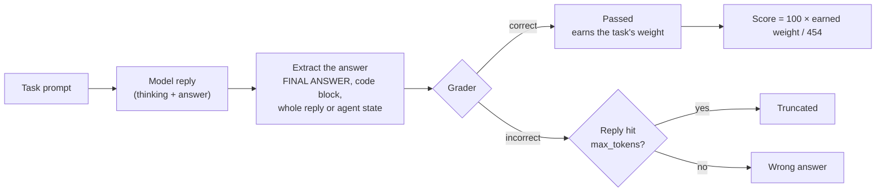

# Qwen3.8-27B pilot run: results overview

This is the first full run of the benchmark: Qwen3.8-27B, 4-bit, on a 24 GB Mac, 16–17 November 2026. It is the
baseline the task weights were calibrated on, so it scores exactly **50.0** by construction. Its useful content is
*where* Qwen3.8 succeeds and fails, which is what Qwen4 will be measured against.



## Setup

| | |
|---|---|
| Model | `qwen3.8:27b` (NVFP4 4-bit) from the Ollama library, served by Ollama 0.40.16 (MLX runner) as `qwen3.8-27b-bench`, `num_ctx` 57,344 |
| Hardware | Apple M4 Pro, 24 GB, `iogpu.wired_limit_mb=21504` |
| Thinking | on, `reasoning_effort` **medium** (Ollama's default; the model card's headline scores use `xhigh`) |
| Sampling | temperature 1.0, top_p 0.95, top_k 20, min_p 0, presence_penalty 0 (model-card thinking settings) |
| Output limit | `max_tokens` 32,768 per reply; agent episodes 98,304 in total |
| Samples | 1 per task |
| Generation time | 11.8 h (the run spread over two days with an overnight pause) |
| Task set | `tasks/tasks.jsonl` sha256 `2b16f141…63bcad4` |
| Weights | `tasks/weights.json` sha256 `da6314ae…65edb1d` (calibrated on this run) |

## How each task is scored



A task's weight is its tier (1–5) if this run passed it, and tier × 2.609 if this run failed it. That puts half of
the 454 points on the 21 failed tasks, so the pilot scores 50.0; with plain tier weights the same answers score 72.3.
The README section [Pilot result and calibrated weights](../../README.md#pilot-result-and-calibrated-weights)
explains the method and its caveat.

## By difficulty tier



| Tier | Tasks | Passed | Wrong answer | Truncated | Pass rate | Weighted score |
|---|---:|---:|---:|---:|---:|---:|
| T1 warm-up | 8 | 8 | 0 | 0 | 100% | 100.0 |
| T2 standard | 20 | 19 | 1 | 0 | 95% | 87.9 |
| T3 hard | 33 | 30 | 2 | 1 | 91% | 79.3 |
| T4 very hard | 28 | 19 | 2 | 7 | 68% | 44.7 |
| T5 frontier | 11 | 3 | 3 | 5 | 27% | 12.6 |
| **All** | **100** | **79** | **8** | **13** | **79%** | **50.0** |

The tiers are ordered as intended: the pass rate falls with every step up. But every tier beat its prior pass rate
(T3: 91% against 0.59 expected, T4: 68% against 0.41), which is why plain tier weights gave 72.3 instead of the
planned ~50. 17 of the 21 failures are in T4 and T5, including 12 of the 13 truncations.

## By category



| Category | Tasks | Passed | Wrong answer | Truncated | Weighted score |
|---|---:|---:|---:|---:|---:|
| long_context | 8 | 8 | 0 | 0 | 100.0 |
| multilingual | 4 | 4 | 0 | 0 | 100.0 |
| structured | 6 | 6 | 0 | 0 | 100.0 |
| agent | 8 | 7 | 0 | 1 | 59.3 |
| math | 14 | 12 | 0 | 2 | 60.5 |
| logic | 12 | 10 | 1 | 1 | 59.0 |
| knowledge | 10 | 8 | 2 | 0 | 48.4 |
| science | 5 | 4 | 0 | 1 | 51.3 |
| instruction | 11 | 8 | 3 | 0 | 37.8 |
| trace | 8 | 5 | 1 | 2 | 32.1 |
| code | 14 | 7 | 1 | 6 | 20.4 |

Three categories are saturated (long context, multilingual, structured): for Qwen4 they can only reveal
regressions. Code is the weakest category, but mostly because six solutions were never written: the model was
still reasoning when it reached 32,768 tokens.

## Every task



Within a category, ids run from easy to hard, so failures cluster at the right-hand end of each row. The only
failure below tier 3 is CODE-03.

## Thinking length and truncation


- The median task used **2,932** completion tokens (reasoning + answer). The median rises with every tier:
  370 (T1), 912 (T2), 3,174 (T3), 6,005 (T4), 18,969 (T5).
- Every truncated task sits exactly at the 32,768 limit, all in T3–T5. Only 3 of the 79 passes needed more than
  20,000 tokens (the longest 30,015), so a reply still thinking past that point rarely came back with an answer.
- AGENT-08 is the one agent task that failed. It used 114,504 tokens over its episode: the 98,304-token episode
  budget is checked before each turn, so the last turn can go past it.
- **Truncation cost more than wrong answers:** 146.1 of the 227 missing points (64%) come from the 13 truncated
  tasks, 80.9 from the 8 wrong answers.

## The 21 failures, audited

Every failure was checked by hand with `tools/audit_run.py --failed`. All are genuine model errors. The audit found
one grader bug, in KNOW-07: "Turkey (Türkiye)" was rejected. It was fixed, and that task now counts as passed.

| Task | Tier | Title | Outcome | What happened |
|---|---|---|---|---|
| CODE-03 | T2 | Arithmetic expression evaluator | Wrong answer | The code raises `UnboundLocalError` in the unary-operator parser; the hidden tests fail |
| CODE-06 | T3 | Shortest path collecting all keys | Truncated | Still reasoning at 32,768 tokens; no code block written |
| IF-07 | T3 | Acrostic with word quotas | Wrong answer | Line 7 has 7 words, which breaks its quota |
| LOGIC-06 | T3 | Two-worker scheduling | Wrong answer | Answered 17; the optimum is 16 (confirmed by exhaustive search) |
| CODE-09 | T4 | Huge-index recurrence | Truncated | No code block within 32,768 tokens |
| CODE-10 | T4 | Distinct palindromic substrings | Truncated | No code block within 32,768 tokens |
| CODE-12 | T4 | Regex matcher without backtracking blow-up | Truncated | No code block within 32,768 tokens |
| IF-08 | T4 | Every sentence exactly 12 words | Wrong answer | Sentence 6 has 13 words |
| KNOW-08 | T4 | Obscure Unicode character name | Wrong answer | Answered ETHIOPIC SMALL LETTER WA; correct is CYRILLIC LETTER MULTIOCULAR O |
| MATH-11 | T4 | Permutations that move every element far | Truncated | No final answer within 32,768 tokens |
| SCI-04 | T4 | Stereoisomer count with a pseudoasymmetric centre | Truncated | No final answer within 32,768 tokens |
| TRACE-04 | T4 | xorshift32 by hand | Truncated | No final answer within 32,768 tokens |
| TRACE-05 | T4 | Game of Life on a torus | Truncated | No final answer within 32,768 tokens |
| AGENT-08 | T5 | Delivery robot under a step budget | Truncated | Ran out of its episode token budget having used 10 of its 64 steps; delivered 0 of 3 packages and walked into a wall |
| CODE-13 | T5 | k-th distinct substring | Truncated | No code block within 32,768 tokens |
| CODE-14 | T5 | Cheapest strictly increasing fix | Truncated | No code block within 32,768 tokens |
| IF-11 | T5 | Staircase acrostic with a letter budget | Wrong answer | The acrostic spells BENCHMERKS instead of BENCHMARKS |
| KNOW-10 | T5 | Unicode punctuation name | Wrong answer | Answered COMBINING LATIN CAPITAL LETTER T; correct is REVERSED QUESTION MARK |
| LOGIC-12 | T5 | Sudoku | Truncated | No final answer within 32,768 tokens |
| MATH-13 | T5 | Digit sum preserved by tripling | Truncated | No final answer within 32,768 tokens |
| TRACE-08 | T5 | Brainfuck with wrap-around | Wrong answer | Output `Q=&`; the program prints `Q8!` |

The 22 passes in T4 and T5 were checked as well. All are clean passes; the only one that relies on lenient answer
parsing is KNOW-07, accepted under the grader fix above.

## What this means for the Qwen4 run

- **Same settings, or the comparison is meaningless.** Truncation decides 13 tasks, so Qwen4 must run with the same
  `max_tokens` (32,768), the same `reasoning_effort` (medium) and the same episode budget. A model that reaches an
  answer in fewer tokens gains most of its points here, which is a fair thing to reward as long as the limits are equal.
- **Where the points are.** The 21 failed tasks hold 227 of the 454 points. The 79 passed tasks hold the other
  227, and any regression there costs points too.
- **Compare like with like.** This run was used to fit the weights, so it is biased towards 50. Compare Qwen4 with a
  fresh Qwen3.8 run under the same weights, ideally with `--samples 2` or more for both.

## Files in this folder

| File | Contents |
|---|---|
| `responses.jsonl` | raw replies, including reasoning, token usage and latency (agent tasks: full transcript) |
| `grades.jsonl` | one grade per task: extracted answer, pass/fail, detail |
| `summary.md`, `summary.json` | the scores in this overview, written by `grade.py` |
| `meta.json` | exact config, task-set hash, timestamps |
| `run.log` | the runner's log (its last line shows the pre-calibration score, 72.3) |
| `charts/` | the charts above |

To regenerate the charts, or draw them for another run (they follow the viewer's light or dark mode):

```bash
python3 tools/plot_run.py results/qwen3.8-27b-nvfp4-ollama --title "Qwen3.8-27B"
```
